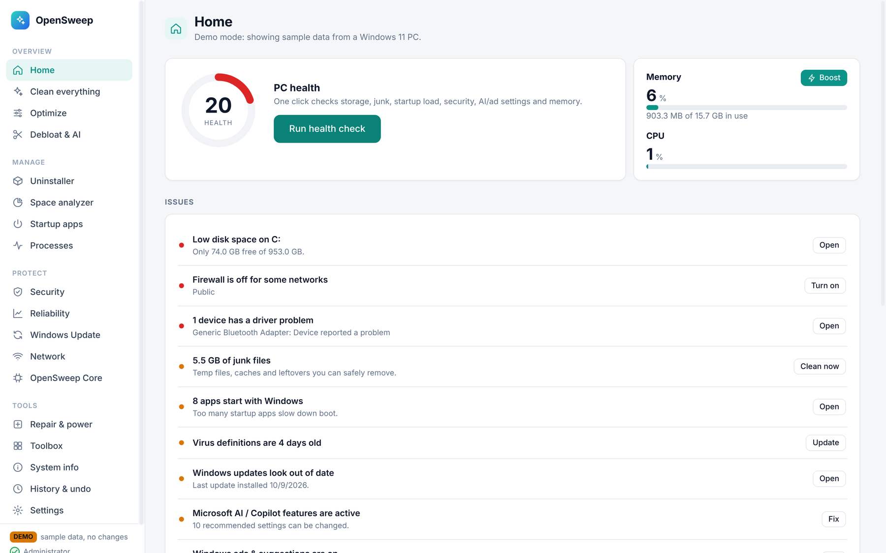
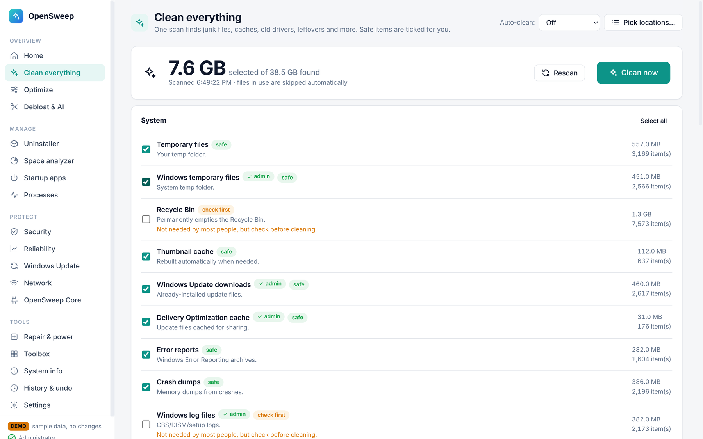
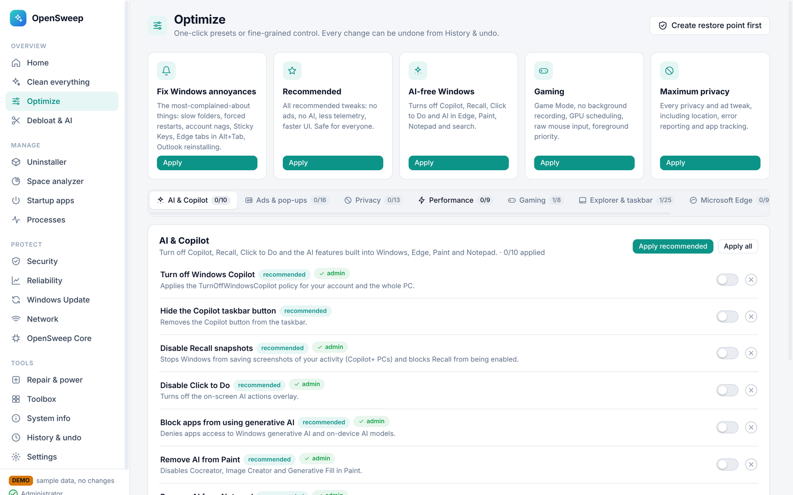
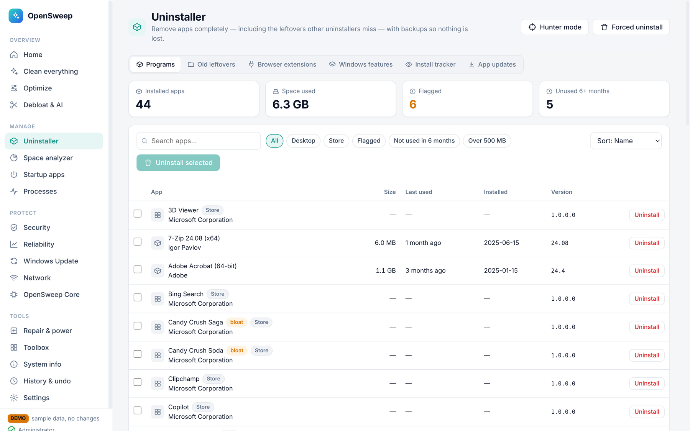
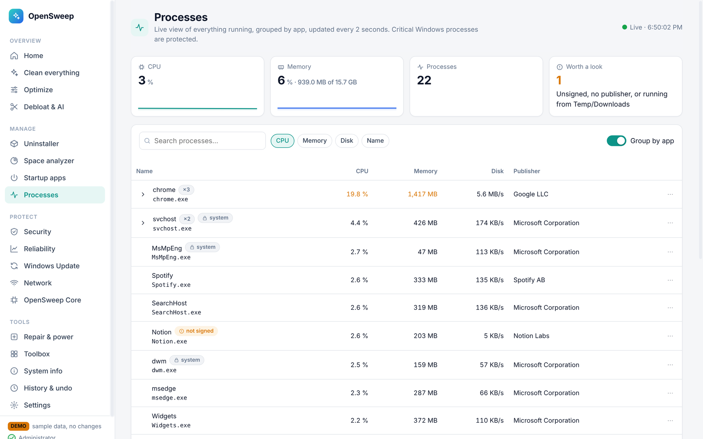
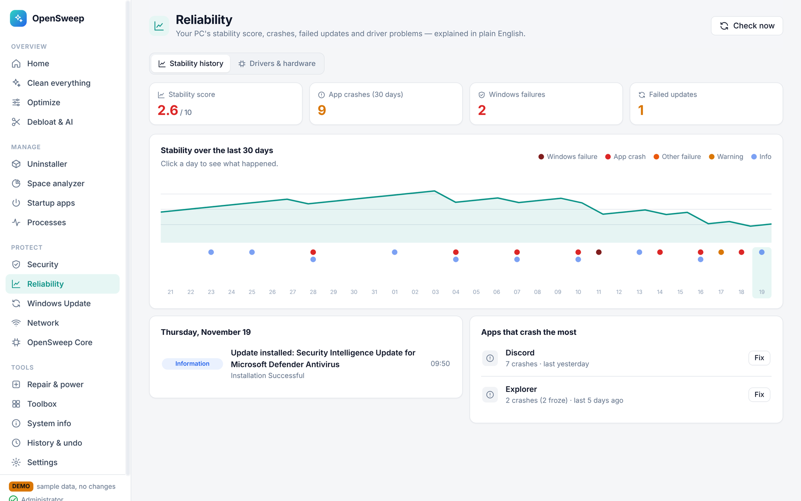
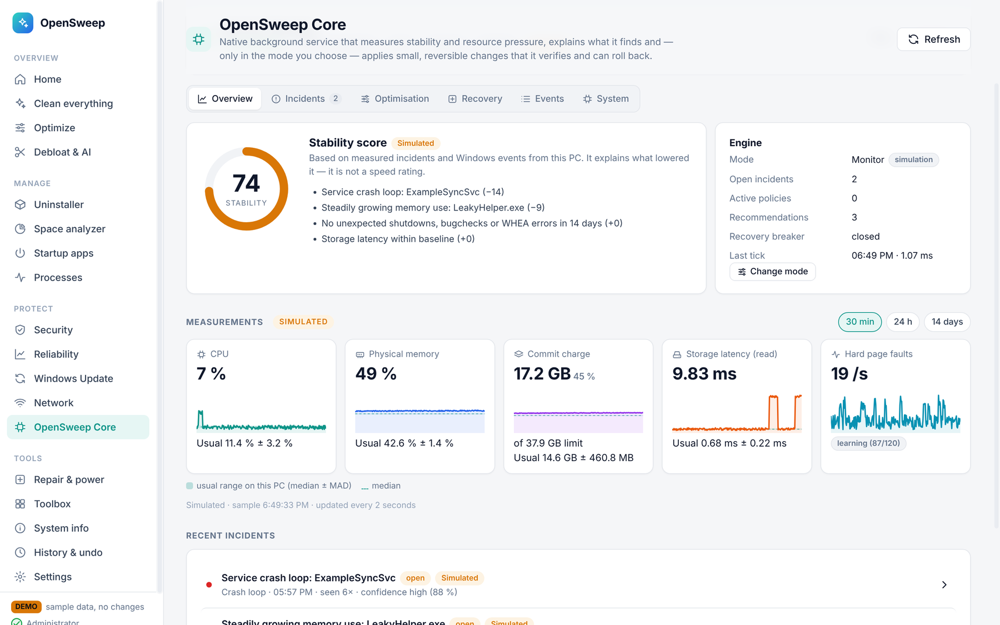
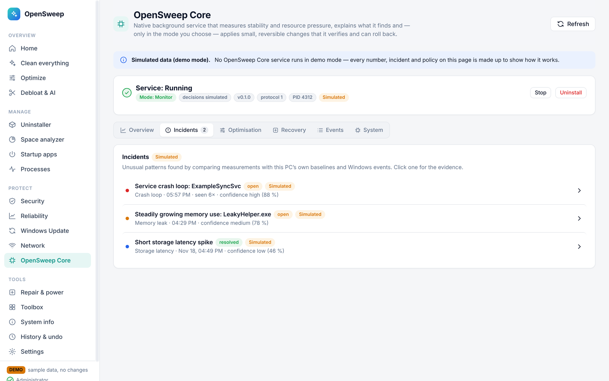
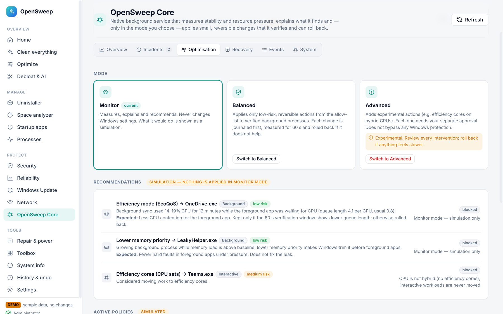

<div align="center">

# ✦ OpenSweep

**Free, open-source PC care for Windows 10 and 11.**
Clean, debloat, remove Microsoft AI, uninstall properly, see what fills your disk, and keep Windows stable, all in one app.
No telemetry, no ads, no account.

[](https://github.com/ray0189/OpenSweep/releases)
[](#install)
[](LICENSE)
[](https://github.com/ray0189/OpenSweep/actions/workflows/windows-test.yml)

[Download](https://github.com/ray0189/OpenSweep/releases) · [Features](#features) · [OpenSweep Core](#opensweep-core-alpha) · [Safety](#safety) · [Build](#build)



</div>

> OpenSweep is an independent project. It is not affiliated with or endorsed by Microsoft.
> Screenshots are from demo mode (sample data).

---

## Features

### 🧹 Clean everything in one click
One scan covers junk, caches, old drivers, Windows.old, old installers and leftovers. Safe items are pre-ticked,
you see one total, and you get a verified report afterwards. Optional weekly or monthly auto-clean when the PC is idle.



### ⚙️ Optimize: 97 reversible tweaks + presets
AI & Copilot, ads & pop-ups, privacy, performance, gaming, Explorer, Edge and Windows Update.
Presets: **Fix Windows annoyances**, Recommended, AI-free, Gaming, Maximum privacy.
Every setting shows a status circle: **✓ applied**, **✗ not applied**, **! Windows didn't keep it**.



### 📦 Uninstaller that finds the leftovers
Desktop and Store apps with size, *last used* and bloat flags. Deep uninstall finds leftover files, registry keys,
services, tasks and shortcuts, with backups and undo. Batch, forced and hunter-mode uninstall, plus browser extensions,
Windows features and an install tracker.



### 📊 Space analyzer
Fast scan of any drive or folder: treemap, folder tree, file types, largest files, file age, growth between scans and
*Insights* on what's safe to remove. Plus duplicate finder, large-file finder and a system-wide file organiser with undo.


### 📈 Live processes and reliability
Live CPU, memory and disk per app, with flags for unsigned programs or programs running from Temp or Downloads.
A 30-day stability timeline shows crashes, failed updates and driver problems, explained in plain English.

<table>
<tr>
<td></td>
<td></td>
</tr>
</table>

### Everything else

| Area | What it does |
|---|---|
| **Debloat & AI** | "Remove all Microsoft AI" (Copilot, Recall, Click to Do, AI in Edge, Paint, Notepad and Search), 39 preinstalled apps, telemetry services and tasks. |
| **Startup apps** | Run keys, startup folders and logon tasks, each with an on/off switch (same flags as Task Manager). |
| **Windows Update** | Stop forced restarts, pause up to a year, lock your version, block driver updates, uninstall a bad update. |
| **Security** | Defender, firewall, UAC, SmartScreen, BitLocker, RDP and SMB1 with one-click fixes. |
| **Drivers & hardware** | Background check for driver problems, blue screens, WHEA errors and disk errors, with notifications. |
| **Network** | DNS switcher, flush DNS, renew IP, hosts editor, latency test. |
| **Repair & power** | Start menu, Search, sound and Bluetooth fixes, SFC, DISM, chkdsk, network and Windows Update reset, power plans. |
| **Settings guard** | If a Windows update switches one of your settings back, OpenSweep puts it back and tells you. |
| **History & undo** | Every change is logged, and tweak, startup and task changes can be undone. |
| **Mini toolbar & tray** | Floating CPU/RAM widget with Boost; tray menu; start with Windows. |

---

## OpenSweep Core (alpha)

A small native background service (C++) that watches your PC's stability and explains what it finds.
It is **in alpha** on the `0.4.0-alpha` pre-releases.



- **Watches**: CPU, memory, commit, disk latency, page faults, per-app usage and Windows error logs. History is kept
  for 30 minutes, 24 hours and 14 days, all on your PC.
- **Learns what's normal** for your PC (about 2 hours), then flags what isn't.
- **Finds problems with evidence**: memory leaks, crash loops, driver and GPU failures, hardware (WHEA) errors,
  slow disks and overheating. Each finding shows a confidence level and says "linked to", never "caused by".
- **Three modes**
  - **Monitor** (default): measures and recommends, changes nothing.
  - **Balanced** (opt-in): small, reversible changes to background apps only when the PC is really struggling.
    Each change is logged first, checked for 60 seconds, and undone if it didn't help.
  - **Advanced**: extra options, each needing your consent.
- **Never touches** the app you're using, audio, games, anti-cheat, antivirus or Windows itself. No RAM "boosting",
  no kernel driver, no cloud.

<table>
<tr>
<td></td>
<td></td>
</tr>
</table>

Tested so far on GitHub's Windows Server test machines: service install, start, stop and uninstall; secure pipe;
a 60-second run using about 17 MB of memory with nothing changed in Monitor mode. Not yet tested on a wide range of
real PCs. See [docs/core](https://github.com/ray0189/OpenSweep/tree/feature/opensweep-core/docs/core) for the full status.

---

## Install

1. Download `OpenSweep Setup x.y.z.exe` (installer) or the portable `.zip` from
   [Releases](https://github.com/ray0189/OpenSweep/releases).
2. The builds aren't code-signed yet, so SmartScreen will warn: choose **More info → Run anyway**.
3. OpenSweep runs as administrator (Windows asks once when it starts).

**Updates** come from this repo's releases automatically (Settings → Updates). Installed copies also receive
pre-releases such as `0.4.0-alpha.1`. Version 0.1.0 can't update itself, so install a newer version once by hand.

## Safety

- Every change is read back from Windows to check it applied, and logged in History.
- Cleanup only touches known cache and temp locations. Files in use are skipped; big deletes go to the Recycle Bin.
- Tweaks use documented Windows policy and registry values. "Off" restores the Windows default.
- **Create a restore point** (Repair & power) before applying presets or debloating.

## Build

Works on macOS, Linux or Windows (Node.js 20+):

```bash
npm install
```

```bash
npm run demo
```

```bash
npm run dist:win
```

`npm run demo` runs the UI with sample data on any OS and changes nothing; `npm start` runs it for real on Windows.
Building OpenSweep Core needs CMake and Visual Studio 2022 (`npm run core:build`).

## How it works

- `src/backend/catalog.js` is a declarative list of every tweak, cleanup target, app, service, task, tool and repair.
  **Most contributions are a single entry here.**
- `src/backend/windows.js` runs everything with the PowerShell 5.1 that ships with Windows. Arguments are passed as
  JSON, so nothing user-controlled is ever spliced into a command line.
- `src/main.js` validates every request from the UI; the UI passes only IDs.
- `core/` (on the `feature/opensweep-core` branch while in alpha) is the native OpenSweep Core service. It talks to the app over a locked-down named pipe; see
  [docs/core/ipc-protocol.md](https://github.com/ray0189/OpenSweep/blob/feature/opensweep-core/docs/core/ipc-protocol.md).

## Releasing

Bump `version` in `package.json`, then run the **Release** GitHub Action (Actions → Release → Run workflow). It builds
OpenSweep Core and the installer on Windows, runs the tests and publishes the release with `latest.yml`. Installed copies
pick it up within a few hours, or straight away via Settings → Check now. The **Windows test** and **OpenSweep Core**
actions run the backend and the service on a Windows VM on every push.

## Licence

MIT. See [LICENSE](LICENSE).
